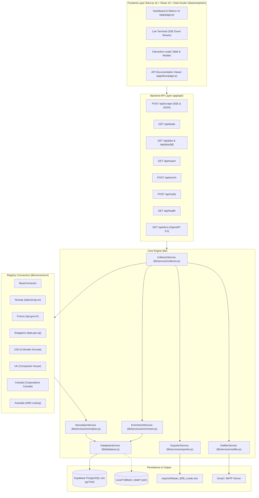

# 🛠️ B2B Lead Scraper — Engineering & Architecture Documentation

This document serves as the comprehensive technical reference for software engineers maintaining, scaling, or extending the B2B Lead Scraper platform.

---

## 🏛️ 1. Architecture Overview

The system is built as a unified fullstack application powered by **Next.js 16 (App Router)**. It replaces legacy decoupled architectures (FastAPI + Streamlit + Celery) with a consolidated, reactive TypeScript/JavaScript architecture capable of running both interactively and headlessly in automated environments.



---

## 📁 2. Codebase Organization

```text
leadscrape/
├── .data/                               # Local JSON fallback store (gitignored)
│   ├── leads.json
│   └── jobs.json
├── .env                                 # Secrets & credentials (strictly gitignored)
├── .env.example                         # Committed template with empty values
├── .gitignore                           # Git ignore rules ensuring zero credential leaks
├── AGENTS.md                            # Next.js 16 framework rules
├── INSTRUCTIONS.md                      # End-user operational guide
├── ENGINEERING.md                       # This engineering documentation
├── SCRAPER_STATUS.md                    # Registry audit and latency benchmarks
├── README.md                            # GitHub repository overview
├── package.json                         # Node dependencies and npm scripts
├── next.config.mjs                      # Turbopack & Next.js compiler settings
│
├── app/                                 # Next.js 16 App Router
│   ├── layout.js                        # Root HTML shell & metadata
│   ├── page.js                          # Full-featured dashboard UI (Tailwind CSS)
│   ├── globals.css                      # Tailwind CSS v4 entrypoint
│   ├── docs/
│   │   └── page.js                      # Interactive OpenAPI documentation viewer
│   └── api/                             # REST API Route Handlers
│       ├── scrape/route.js              # Trigger scrape with optional SSE streaming
│       ├── leads/route.js               # Search, filter, and pagination
│       ├── jobs/route.js                # List job history
│       ├── jobs/[id]/route.js           # Single job details and logs
│       ├── export/route.js              # Binary stream of Master_B2B_Leads.xlsx
│       ├── custom-export/               # B2B Newspaper Invoice Data Exporter endpoints
│       │   ├── master/route.js          # Loads scraped Master Excel dataset or fallback DB
│       │   ├── parse/route.js           # Multi-part upload parser for external spreadsheets
│       │   └── download/route.js        # Dynamic generator streaming filtered custom Excel
│       ├── enrich/route.js              # Website contact enrichment
│       ├── notify/route.js              # SMTP test & summary dispatch
│       ├── health/route.js              # System diagnostic health check
│       └── docs/route.js                # OpenAPI 3.0 JSON specification
│
├── lib/                                 # Core libraries and business logic
│   ├── config.js                        # Centralized configuration & env loader
│   ├── models.js                        # Zod runtime schemas (Lead, Job, Request)
│   ├── database.js                      # Dual-mode PostgreSQL / local database service
│   ├── connectors/                      # International Registry Connectors
│   │   ├── base.js                      # Abstract base connector class
│   │   ├── index.js                     # Connector catalog & resolver
│   │   ├── norway_brreg.js              # Norway (data.brreg.no)
│   │   ├── france_insee.js              # France (api.gouv.fr)
│   │   ├── singapore_acra.js            # Singapore ACRA (data.gov.sg)
│   │   ├── usa_socrata.js               # USA Colorado (data.colorado.gov)
│   │   ├── companies_house.js           # UK Companies House API
│   │   ├── canada_ised.js               # Canada Corporations Open Data
│   │   └── australia_abn.js             # Australia ABN Lookup
│   └── services/                        # Domain Services
│       ├── collector.js                 # Job orchestrator & concurrency coordinator
│       ├── normalizer.js                # Cleaning & 2-stage de-duplication
│       ├── enrichment.js                # Polite Cheerio website crawler
│       ├── exporter.js                  # ExcelJS workbook generator
│       └── notifier.js                  # Nodemailer SMTP job completion dispatcher
│
├── exports/                             # Output directory
│   └── Master_B2B_Leads.xlsx            # Generated Master Excel file
│
├── scripts/                             # Maintenance & verification scripts
│   ├── run-scraper.mjs                  # Headless automated CLI runner
│   ├── test-connectors.mjs              # Connector validation test suite (20 records each)
│   ├── diagnose-scrapers.mjs            # Latency and API readiness diagnostic
│   ├── verify-live-origin.mjs           # Live government origin verification
│   └── migrate-supabase.mjs             # Automatic PostgreSQL schema migration
│
└── supabase/
    └── schema.sql                       # Complete PostgreSQL DDL with RLS and indexes
```

---

## 🗄️ 3. Database Architecture & Resiliency

### 3.1 PostgreSQL Schema (`supabase/schema.sql`)
The schema defines two core tables in the `public` schema with Row Level Security (RLS) enabled:

1. **`leads` Table**:
   * `id`: UUID PRIMARY KEY (default `gen_random_uuid()`)
   * `company_name`: `TEXT NOT NULL`
   * `registration_number`: `TEXT`
   * `country`: `TEXT NOT NULL`
   * `status`: `TEXT DEFAULT 'Active'`
   * `incorporation_date`: `TEXT`
   * `company_type`: `TEXT`
   * `address`: `TEXT`
   * `city`: `TEXT`
   * `postal_code`: `TEXT`
   * `director`: `TEXT`
   * `website`: `TEXT`
   * `email`: `TEXT`
   * `phone`: `TEXT`
   * `industry`: `TEXT`
   * `source`: `TEXT NOT NULL`
   * `enrichment_status`: `TEXT DEFAULT 'pending'` (`pending`, `enriched`, `failed`, `not_found`)
   * `created_at`: `TIMESTAMPTZ DEFAULT NOW()`
   * `updated_at`: `TIMESTAMPTZ DEFAULT NOW()`

2. **`scrape_jobs` Table**:
   * `id`: UUID PRIMARY KEY
   * `countries`: `JSONB NOT NULL DEFAULT '[]'`
   * `status`: `TEXT NOT NULL DEFAULT 'running'` (`running`, `completed`, `failed`)
   * `leads_collected`: `INTEGER DEFAULT 0`
   * `duplicates_skipped`: `INTEGER DEFAULT 0`
   * `errors_count`: `INTEGER DEFAULT 0`
   * `started_at`: `TIMESTAMPTZ DEFAULT NOW()`
   * `finished_at`: `TIMESTAMPTZ`
   * `logs`: `JSONB DEFAULT '[]'`
   * `summary`: `TEXT`

### 3.2 Dual-Mode Persistence Strategy (`lib/database.js`)
To guarantee that the application never halts due to database unavailability, `DatabaseService` implements a 3-tier fallback hierarchy:

1. **Tier 1 (Direct PostgreSQL Pool)**: If `DATABASE_URL` is set, the service creates a `pg.Pool` with SSL (`rejectUnauthorized: false`) and a max connection count of 10. All queries execute via native parameterized SQL.
2. **Tier 2 (Supabase Client SDK)**: If `DATABASE_URL` is unavailable but `NEXT_PUBLIC_SUPABASE_URL` and `SUPABASE_SERVICE_ROLE_KEY` exist, queries fallback to `@supabase/supabase-js`.
3. **Tier 3 (Local JSON Storage)**: If network connectivity to Supabase fails or credentials are unconfigured, data seamlessly writes to `.data/leads.json` and `.data/jobs.json`.

---

## 🧩 4. Connector Architecture (`lib/connectors/`)

All country scrapers extend the abstract `BaseConnector` class defined in `lib/connectors/base.js`.

### 4.1 The `BaseConnector` Contract
```javascript
export class BaseConnector {
  constructor(code, countryName, registryName, requiresAuth = false)
  async sleep(ms)
  async safeFetch(url, headers = {}, retries = 3)
  async search(query = '', limit = 20) // Must return normalized lead objects
}
```

#### Built-in Politeness & Rate-Limit Handling:
* **Standard User-Agent**: Transmits `B2BLeadScraper/1.0 (+https://github.com/the-corent/leadscrape; contact@example.com)` on every request.
* **HTTP 429 Handling**: Automatically performs exponential backoff:
  $$\text{delay} = 2^{\text{attempt}} \times 1500\,\text{ms}$$
* **Timeout Protection**: Enforces an `AbortController` timeout (default 15,000ms).

### 4.2 How to Add a New Country Connector
To implement an additional country registry (e.g. Germany or New Zealand):

1. Create `lib/connectors/<country>_<source>.js`:
```javascript
import { BaseConnector } from './base.js';

export class GermanyConnector extends BaseConnector {
  constructor() {
    super('DE', 'Germany', 'Handelsregister API', false);
  }

  async search(query = '', limit = 20) {
    const url = `https://api.example.de/companies?q=${encodeURIComponent(query)}&limit=${limit}`;
    const data = await this.safeFetch(url);

    return data.items.map(item => ({
      company_name: item.name,
      registration_number: item.hrb_number,
      country: 'Germany',
      status: 'Active',
      incorporation_date: item.date,
      company_type: 'GmbH',
      address: item.address,
      city: item.city,
      postal_code: item.zip,
      director: item.managing_director,
      website: item.website || '',
      email: item.email || '',
      phone: item.phone || '',
      industry: item.wz2008_code || '',
      source: this.registryName,
      enrichment_status: 'pending'
    }));
  }
}

export const germanyConnector = new GermanyConnector();
```
2. Register the connector in `lib/connectors/index.js` under `CONNECTORS`.
3. Add the country code to the UI list in `app/page.js`.

---

## ⚙️ 5. Core Services Layer

### 5.1 Normalization & De-Duplication (`lib/services/normalizer.js`)
* **Company Names**: Strips duplicate whitespaces and outer punctuation.
* **Phone Numbers**: Normalizes characters to digits, plus signs, and hyphens. Drops invalid strings with fewer than 6 or greater than 16 digits.
* **Email Validation**: Enforces RFC regex, strips invalid media extensions (`.png`, `.svg`, `.css`), and excludes dummy domains (`example.com`, `test.com`).
* **2-Stage De-Duplication**:
  1. **Primary Check**: `(country, registration_number)` matching (case-insensitive).
  2. **Secondary Check**: `(country, LOWER(TRIM(company_name)))`.

### 5.2 Website Enrichment Engine (`lib/services/enrichment.js`)
* **Strict Outreach Compliance**: **NEVER guesses or extrapolates email patterns**.
* **Traversal Algorithm**:
  1. Validates company website URL.
  2. Fetches homepage HTML with 8-second timeout.
  3. Uses `cheerio` to scan `a[href^="mailto:"]`, `a[href^="tel:"]`, and text regex.
  4. If contacts are missing, identifies candidate contact links (`/contact`, `/contact-us`, `/about`) and evaluates the first target page after a 1000ms polite pause.

### 5.3 Excel Exporter (`lib/services/exporter.js`)
* Built with `exceljs`.
* Outputs to `exports/Master_B2B_Leads.xlsx`.
* **Lead Priority Hierarchy**:
  * **Priority 1 (Primary Contact)**: Phone number & Email address are promoted to the first actionable columns directly after Company Name (`Phone` = col 2, `Email` = col 3). All records with both Phone & Email are sorted to the very top rows.
  * **Priority 2 (Web Presence)**: `Website` is positioned in column 4. Leads with verified websites rank immediately after direct contacts.
  * **Priority 3 (Corporate Identification & Legal)**: `Director / Officers`, `Registration Number`, `Status`, `Address`, `City`, `Postal Code`, `Industry`, `Country`, etc. follow in logical order.
* **Design Specifications**:
  * Frozen header row (`ySplit: 1`).
  * Header fill: Dark Navy `#1E293B`, White bold font, 28pt row height.
  * Auto-filter enabled across all 16 columns.
  * Zebra row striping (`#F8FAFC` on even rows).
  * Auto-calculated column widths with content padding.
  * Missing values strictly left as empty strings (`''`).

### 5.4 Email Notifier (`lib/services/notifier.js`)
* Uses `nodemailer` configured with SMTP credentials.
* **Dual Operation**:
  1. `sendJobSummary(jobStats, countries, excelAttachment)`: Automated post-scrape summary with KPI counters and attachment.
  2. `sendCustomEmail({ recipient, subject, customNote, totalLeads, countries, excelAttachment })`: Custom dispatch called from the Web UI Email Dispatch Center with customized executive notes and country-filtered Excel attachments.
* Attaches `exports/Master_B2B_Leads.xlsx` directly to outgoing emails as a streamable Buffer or resolved filesystem path.

### 5.5 Excel Parser & Column Mapper (`lib/services/excel-parser.js`)
* Powers the **B2B Newspaper Invoice Data Exporter**.
* **Auto-Discovery & Disk Caching**: On initial mount, reads `exports/Master_B2B_Leads.xlsx` from disk and extracts dynamic headers, unique industries, and unique cities. Falls back gracefully to querying database leads if the file is absent.
* **Binary Buffer Parsing**: Parses multipart user-uploaded `.xlsx` or `.csv` files into structured records without requiring disk writes.
* **Intelligent Metrics Computation**: Evaluates company status across rows to dynamically count active vs. inactive records (`activeRecords`, `inactiveRecords`).

### 5.6 Dynamic Custom Excel Generation (`generateCustomExcel` in `lib/services/exporter.js`)
* Generates on-demand streaming `.xlsx` workbooks containing **only user-selected columns** and filtered rows.
* Preserves dark navy freeze-header styling (`#1E293B`), zebra striping (`#F8FAFC`), and dynamic auto-fit column widths.
* Direct in-memory buffer streaming prevents file-system bloat on export servers.

---

## 📡 6. API Route Contracts

### `POST /api/scrape`
Triggers an automated scrape across selected registries.
* **Headers**: `Accept: text/event-stream` (for SSE) or `Content-Type: application/json`.
* **Request Payload**:
  ```json
  {
    "countries": ["NO", "FR", "SG", "US"],
    "query": "shipping",
    "limit": 20,
    "enrich": true,
    "delayMs": 1000,
    "stream": true
  }
  ```
* **SSE Event Types**:
  * `event: status`: Initial job status payload.
  * `event: log`: Real-time streaming log entry `{ timestamp, level, message }`.
  * `event: complete`: Final job result `{ leadsCollected, duplicatesSkipped, errorsCount }`.
  * `event: error`: Error message payload.

### `GET /api/leads`
Retrieves leads with filtering and pagination.
* **Query Parameters**:
  * `country`: (string) Filter by country name.
  * `search`: (string) Search term across company, director, registration number.
  * `hasEmail`: (`"true"` | `"false"`)
  * `hasPhone`: (`"true"` | `"false"`)
  * `limit`: (integer, default 100)
* **Response**:
  ```json
  {
    "success": true,
    "count": 24,
    "leads": [...]
  }
  ```

### `GET /api/export`
Generates and streams the binary Excel file.
* **Response Headers**:
  * `Content-Type: application/vnd.openxmlformats-officedocument.spreadsheetml.sheet`
  * `Content-Disposition: attachment; filename="Master_B2B_Leads.xlsx"`

### `POST /api/notify`
Dispatches customized executive lead summaries and attaches `Master_B2B_Leads.xlsx` via SMTP.
* **Request Payload**:
  ```json
  {
    "recipient": "saurabhkumar.sakr@gmail.com",
    "subject": "B2B Leads Report — 24 Companies",
    "customNote": "Please find attached the latest verified registry leads.",
    "country": "Norway",
    "attachExcel": true
  }
  ```
* **Response**:
  ```json
  {
    "success": true,
    "configured": true,
    "result": {
      "sent": true,
      "messageId": "<...>",
      "recipient": "saurabhkumar.sakr@gmail.com",
      "timestamp": "2026-10-11T09:48:15.131Z"
    },
    "leadsCount": 24
  }
  ```

### `GET /api/health`
System diagnostics and connector readiness.
* **Response**:
  ```json
  {
    "status": "healthy",
    "database": { "mode": "supabase", "status": "connected" },
    "email": { "isConfigured": true, "recipient": "saurabhkumar.sakr@gmail.com" },
    "stats": { "totalLeads": 24, "totalJobs": 4 }
  }
  ```

### `GET /api/custom-export/master`
Loads and parses `exports/Master_B2B_Leads.xlsx` (or database leads fallback).
* **Response**:
  ```json
  {
    "success": true,
    "data": {
      "fileName": "Master_B2B_Leads.xlsx",
      "totalRecords": 59,
      "activeRecords": 56,
      "inactiveRecords": 3,
      "columns": ["Company Name", "Registration Number", "Status", "..."],
      "industries": ["Advertising", "Information Technology", "..."],
      "cities": ["Oslo", "Paris", "Singapore", "..."],
      "records": [...]
    }
  }
  ```

### `POST /api/custom-export/parse`
Parses an uploaded `.xlsx` or `.csv` spreadsheet buffer via multipart `FormData`.
* **Request**: `FormData` with `file` binary.
* **Response**: Same structured JSON payload as `/api/custom-export/master`.

### `POST /api/custom-export/download`
Generates and streams a custom-filtered `.xlsx` workbook containing only selected columns.
* **Request Payload**:
  ```json
  {
    "rows": [ { "Company Name": "Acme Corp", "Phone": "+1234567890", "Email": "contact@acme.com" } ],
    "selectedColumns": ["Company Name", "Phone", "Email"],
    "fileName": "Newspaper_Invoices.xlsx"
  }
  ```
* **Response**: Binary `.xlsx` stream (`application/vnd.openxmlformats-officedocument.spreadsheetml.sheet`).

---

## 🔐 7. Security & Compliance Checklist

1. **Credentials Isolation**: All API keys, database URLs, and SMTP passwords reside strictly in `.env`. The file is ignored by `.gitignore` from commit #1. No keys are ever exposed in frontend bundles or responses.
2. **Outreach & Data Ethics**:
   * Data collection is restricted to public corporate registries.
   * Email scraping is limited to publicly visible contact information on company websites.
   * Polite crawling headers identifying the platform (`User-Agent`) are sent on all requests.
3. **Database Security**:
   * Row Level Security (RLS) is active on `leads` and `scrape_jobs`.
   * Queries use parameterized SQL (`$1, $2, ...`) preventing SQL injection.

---

## 🧪 8. Developer CLI & Verification Suite

Engineers can run automated verification tools directly from the terminal:

```bash
# 1. Run live registry verification (20 records per connector)
npm test

# 2. Run latency and connector health audit
node scripts/diagnose-scrapers.mjs

# 3. Verify Excel leads against live government registries
node scripts/verify-live-origin.mjs

# 4. Run standalone headless scrape
npm run scrape -- --query=logistics --limit=10

# 5. Run Next.js production build check
npm run build
```
