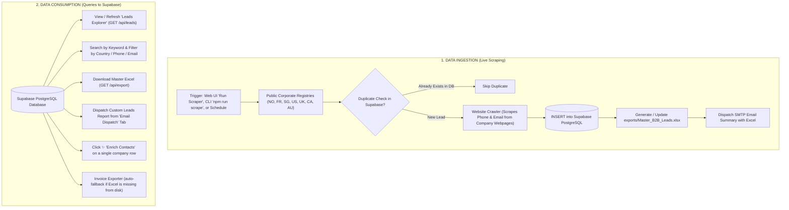

# 🔄 Data Flow & System Workflow Architecture

This document explains the lifecycle of data in the **B2B Lead Scraper**: specifically **when data is scraped live from external sources** and **when data is read from Supabase (PostgreSQL)**.

---

## 🗺️ 1. High-Level Workflow Architecture



---

## 🚀 2. When Does It SCRAPE Data? (Live External Ingestion)

The scraper contacts external networks **only when a scrape job is explicitly triggered**.

### 2.1 Trigger Channels
1. **Interactive Web UI**: You navigate to the **Scraper Control** tab, configure country checkboxes and search keywords, and click **"Start Lead Scraping Job"** (`POST /api/scrape`).
2. **Headless CLI Command**: You or a background script run:
   ```bash
   npm run scrape
   # Or with custom flags:
   node scripts/run-scraper.mjs --query=logistics --limit=20
   ```
3. **Automated Windows Task Scheduler / Cron**: A pre-scheduled OS task runs headless scraping on a periodic schedule (e.g., daily at 9:00 AM).
4. **Direct API Integration**: An external webhook or service sends a JSON payload to `POST /api/scrape`.

### 2.2 Ingestion Step-by-Step
1. **Connects to Official Registries**: Connects via HTTPS to public open data portals (Norway BRREG, France api.gouv.fr, Singapore ACRA, US Colorado Socrata, UK Companies House).
2. **Normalizes Records**: Formats company names, removes punctuation artifacts, standardizes telephone numbers, and validates email syntax.
3. **Queries Supabase for Duplicates**:
   Before saving, the scraper checks Supabase to verify if the company is already stored:
   ```sql
   SELECT id, company_name FROM leads WHERE country = $1 AND registration_number = $2 LIMIT 1;
   ```
   If a match is found, the lead is **skipped** to prevent duplicate rows.
4. **Crawls Company Websites for Contacts (Enrichment)**:
   If enrichment is enabled and the company has an official website URL, the scraper politely visits the website homepage, `/contact`, and `/about` pages to discover publicly listed **phone numbers** and **email addresses**.
5. **Inserts New Leads into Supabase**:
   Stores the normalized, enriched lead record into Supabase PostgreSQL:
   ```sql
   INSERT INTO leads (company_name, phone, email, website, country, ...) VALUES (...);
   ```
6. **Regenerates Master Excel & Sends Notification**:
   Once all registries have been processed, the system exports all leads from Supabase into [`exports/Master_B2B_Leads.xlsx`](file:///d:/internship/the-corent/leadscrape/exports/Master_B2B_Leads.xlsx) (with **Phone & Email prioritized first**) and sends an email summary with the workbook attached.

---

## 📊 3. When Does It TAKE Data From Supabase? (Queries & Views)

Supabase is queried whenever users view, search, export, or communicate with already-stored leads. **No web scraping occurs during these actions.**

| User Action | Endpoint Called | Supabase SQL Execution |
| :--- | :--- | :--- |
| **Viewing Leads Explorer** | `GET /api/leads` | Queries stored leads ordered by contact quality: Phone/Email (1st) $\rightarrow$ Website (2nd) $\rightarrow$ Rest. |
| **Searching or Filtering** | `GET /api/leads?search=...&country=...` | Executes parameterized `ILIKE` and boolean checks against `leads`. |
| **Viewing Job History** | `GET /api/jobs` | Queries `SELECT * FROM scrape_jobs ORDER BY created_at DESC`. |
| **Exporting Master Excel** | `GET /api/export` | Calls `db.getAllLeads()` from Supabase and streams the Excel workbook. |
| **Sending Email Reports** | `POST /api/notify` | Queries Supabase leads matching the recipient's desired country scope. |
| **Enriching a Single Lead** | `POST /api/enrich` | Reads the company's website from Supabase, crawls it, and updates the row. |
| **Invoice Exporter Fallback** | `GET /api/custom-export/master` | If `exports/Master_B2B_Leads.xlsx` is not found on disk, it queries Supabase. |
| **Checking System Health** | `GET /api/health` | Executes a ping query against Supabase (`SELECT 1`) to confirm connectivity. |

---

## 🎯 4. Priority Ranking Hierarchy

Across both the database layer and Excel generation, leads and columns strictly obey the **3-tier priority hierarchy**:

```text
Priority 1: Phone Number & Email ID  (Direct actionable contact channels)
Priority 2: Website URL              (Corporate digital presence)
Priority 3: Corporate Metadata       (Company Name, Director, Reg. Number, Address, City, Industry, Status)
```

* In **Supabase queries**, records with both Phone & Email are sorted to the very top rows.
* In **Excel workbooks**, `Phone` (col 2), `Email` (col 3), and `Website` (col 4) are placed immediately following `Company Name`.
* In the **B2B Newspaper Invoice Exporter**, leads and column selectors are highlighted and pre-sorted according to this hierarchy.

---

## 🛡️ 5. Dual-Mode Resilience & The `.data/` Folder

The application includes a dual-mode database engine in [`lib/database.js`](file:///d:/internship/the-corent/leadscrape/lib/database.js):

* **Primary Mode (Cloud)**: Supabase PostgreSQL connected via connection pooling (`pg.Pool`).
* **Fallback Mode (Local)**: The `.data/` directory (`leads.json` and `jobs.json`).

### Why `.data/` exists:
If Supabase is offline, internet connection drops, or a new developer runs the code without cloud database keys:
1. The app **never crashes**.
2. Scraped leads and job logs are saved locally into `.data/leads.json`.
3. The `.data/` folder is **strictly gitignored** in `.gitignore` so local mock data never leaks to GitHub.

---

## 📋 6. Summary Matrix

| Operation | Scrapes Live Web? | Reads from Supabase? | Writes to Supabase? |
| :--- | :---: | :---: | :---: |
| **Run Scrape Job** | ✅ **YES** | ✅ (for duplicate checks) | ✅ **YES** (inserts new leads) |
| **View Leads Explorer** | ❌ No | ✅ **YES** | ❌ No |
| **Filter by Country / Contact** | ❌ No | ✅ **YES** | ❌ No |
| **Export Master Excel** | ❌ No | ✅ **YES** | ❌ No |
| **Invoice Data Exporter** | ❌ No | ✅ (if Excel not on disk) | ❌ No |
| **Send Email Dispatch** | ❌ No | ✅ **YES** | ❌ No |
| **Single Lead Enrichment** | ✅ **YES** (only target site) | ✅ (reads target website) | ✅ **YES** (updates contact info) |
